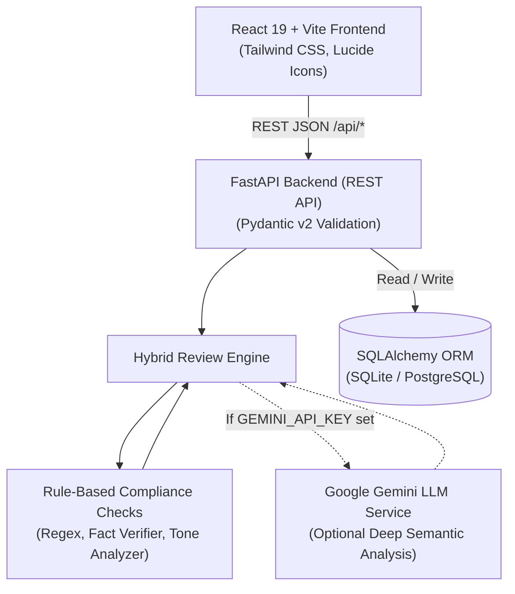

# BrandGuard AI
> **Create Freely. Publish Confidently.**

[](https://python.org)
[](https://fastapi.tiangolo.com)
[](https://react.dev)
[](https://vitejs.dev)
[](https://tailwindcss.com)
[](https://www.sqlalchemy.org)

**BrandGuard AI** is an intelligent brand governance and content compliance platform. Organizations create and publish marketing copy across distributed employees, agencies, and generative AI tools. This frequently leads to tone inconsistencies, unverified promotional superlatives, prohibited terminology, and factual discrepancies.

BrandGuard AI evaluates submitted marketing copy against approved brand guidelines, validated internal facts, and strict terminology policies before publication, offering actionable correction suggestions with a human-in-the-loop review workflow.

---

## 👥 Hackathon Team: Reverse Engg

- **Shivam Gupta** — Software Architect & Backend Lead
- **Uzma Nayab** — Full-Stack Engineer & AI Review Engine
- **Aaysha Shams** — UI/UX Designer & Frontend Lead

---

## 🚀 Key Features

1. **Brand Workspace Management (Module A)**
   - Configure brand profiles with target audience, preferred tone, and detailed category-specific guidelines (Tone, Legal, Messaging, Formatting).
   - Manage Approved Facts repository with document source citations.
   - Maintain Prohibited Terminology lists with approved enterprise alternatives and policy reasons.

2. **Content Submission & Pre-flight Verification (Module B)**
   - Multi-channel copy analysis: Social media posts, Advertisement copy, Website content, Marketing emails.
   - **1-Click Hackathon Test Case Bar**: Instant evaluation of all 5 specification test cases for judges.

3. **Hybrid AI & Rule-based Compliance Engine (Module C)**
   - **Deterministic Compliance Rules**: Instant regex-based phrase boundary matching for prohibited words, speculative guarantees (e.g. "10x growth"), zero-risk promises, and colloquial tone slang.
   - **Deep Semantic Analysis (LLM)**: Seamless Google Gemini integration when an API key is provided, with graceful fallback to the rule engine if offline.
   - **Responsible AI Safeguards**: Submitted text is treated as untrusted data with prompt injection isolation. Strictly no hallucinated facts or evidence.
   - **Clear Categorization**: Distinguishes between *Confirmed Conflict*, *Unsupported Claim*, *Unverified Statement*, and *Style Recommendation*.

4. **Review Results Dashboard (Module D)**
   - Real-time summary metrics: Total issues, High, Medium, Low severity, and Unverified claims.
   - Interactive issue cards displaying category, severity, problematic text span, rule citation, and suggested replacement.

5. **Human-Controlled Correction Workflow (Module E & F)**
   - Interactive **Accept** / **Reject** suggestion buttons.
   - Non-destructive: Original draft is strictly preserved and never overwritten without user confirmation.
   - Live dual-pane preview: Original copy with highlighted spans vs. live revised draft.
   - Manual in-place text editor for editorial fine-tuning.
   - Human review status transitions: `Draft` ➔ `In Review` ➔ `Changes Requested` ➔ `Approved`.

---

## 🏗️ System Architecture



---

## 🛠️ Technology Stack

- **Frontend**: React 19, Vite 8, JavaScript (ESM), Tailwind CSS, Lucide React icons.
- **Backend**: Python 3.11+, FastAPI, Pydantic v2, SQLAlchemy 2.0.
- **Database**: SQLite (default local fallback) or PostgreSQL (production via `DATABASE_URL`).
- **AI Integration**: Google Gemini API (`gemini-1.5-flash`), with deterministic rule engine fallback.
- **Testing**: Pytest, Pytest-Asyncio, HTTPX TestClient.

---

## 🏁 Quick Start & Setup

### Prerequisites
- Python 3.11+
- Node.js 18+ and npm

### 1. Clone & Setup Backend

```bash
cd backend

# Create virtual environment
python -m venv venv

# Activate virtual environment
# Windows:
venv\Scripts\activate
# Linux/macOS:
source venv/bin/activate

# Install dependencies
pip install -r requirements.txt

# Configure environment variables
cp .env.example .env

# (Optional) Seed demonstration brands & sample rules
python seed.py

# Start FastAPI development server
uvicorn app.main:app --reload --port 8000
```
Backend API will be live at: `http://localhost:8000`  
Interactive Swagger Docs at: `http://localhost:8000/docs`

### 2. Setup & Start Frontend

```bash
cd frontend

# Install packages
npm install

# Start Vite dev server
npm run dev
```
Frontend Web Application will be live at: `http://localhost:5173`

---

## 🧪 Automated Testing Suite

All 5 core test cases required by the competition specification are fully implemented and verified in the automated test suite:

| Test Case | Scenario | Expected Result | Status |
| :--- | :--- | :--- | :---: |
| **Test Case 1** | Compliant Content | Tone & approved facts match; 0 high-severity violations | ✅ Passed |
| **Test Case 2** | Unsupported Claim (`We guarantee 10x growth...`) | Flagged as Unsupported Claim | ✅ Passed |
| **Test Case 3** | Prohibited Terminology (`cheapest in India`) | Flagged as Confirmed Conflict with approved replacement | ✅ Passed |
| **Test Case 4** | Tone Inconsistency (`Hey guys!! rn grab this insane deal tbh lol`) | Flagged as Style Recommendation / Tone Inconsistency | ✅ Passed |
| **Test Case 5** | Unverified Claim (`powers over 75,000 merchants`) | Flagged as Unverified Statement (not automatically false) | ✅ Passed |
| **Integration** | Full Review Workflow (Submit ➔ Accept Suggestion ➔ Approve) | Real DB updates, status transitions, revised text sync | ✅ Passed |

### Running the Tests:
```bash
cd backend
venv\Scripts\python -m pytest tests -v
```

---

## 🔌 API Endpoints Reference

| Method | Endpoint | Description |
| :--- | :--- | :--- |
| `GET` | `/api/health` | System health, database connectivity, and engine mode |
| `GET` | `/api/dashboard/stats` | Real computed database metrics (reviews, issues, approvals) |
| `POST` | `/api/brands` | Create a brand workspace with guidelines, facts, and banned words |
| `GET` | `/api/brands` | List all brands with summary counters |
| `GET` | `/api/brands/{id}` | Retrieve full brand details with nested relations |
| `PUT` | `/api/brands/{id}` | Update brand profile information |
| `DELETE` | `/api/brands/{id}` | Delete brand and cascade associations |
| `POST` | `/api/brands/seed` | Seed realistic demo brand profiles |
| `POST` | `/api/reviews` | Submit marketing copy for automated compliance review |
| `GET` | `/api/reviews` | Retrieve review audit history with filtering |
| `GET` | `/api/reviews/{id}` | Retrieve detailed review results, issues, and drafts |
| `PATCH` | `/api/reviews/{id}/status` | Update human review status (`Draft`, `In Review`, `Changes Requested`, `Approved`) |
| `POST` | `/api/reviews/{id}/apply-suggestion` | Accept or reject a specific suggestion |
| `PUT` | `/api/reviews/{id}/content` | Manually edit and save revised content |
| `DELETE` | `/api/reviews/{id}` | Delete a review record |

---

## 🔒 Responsible AI & Security

1. **Prompt Injection Defense**: Submitted marketing copies are parsed as untrusted raw strings and quarantined inside JSON payloads with explicit boundary instructions.
2. **Anti-Hallucination Grounding**: The engine only flags factual contradictions if an approved fact exists in the brand repository. Missing evidence is categorized as "Unverified Statement", never fabricated.
3. **Human Agency**: Automated publication is intentionally prevented. Human editors maintain full control over accepting, rejecting, or amending revisions.
4. **Environment Isolation**: API credentials and database connection strings are managed strictly through environment variables.

---

## 📈 Known Limitations & Future Scope

### Known Limitations
- The current LLM semantic enhancement uses zero-shot prompting; fine-tuning or vector embeddings (RAG) can provide higher precision for large 100+ page corporate brand books.
- Document uploads currently accept raw text copy (PDF / DOCX ingestion not yet built in MVP).

### Future Roadmap
- **CMS & Social Integrations**: Direct pre-publish plugins for WordPress, HubSpot, LinkedIn, and X.
- **RAG for Complex Guidelines**: Vector database integration (Chroma / pgvector) for searching enterprise brand PDFs.
- **Multi-Brand Voice Switching**: Instant translation between corporate sister brands or regional brand divisions.
